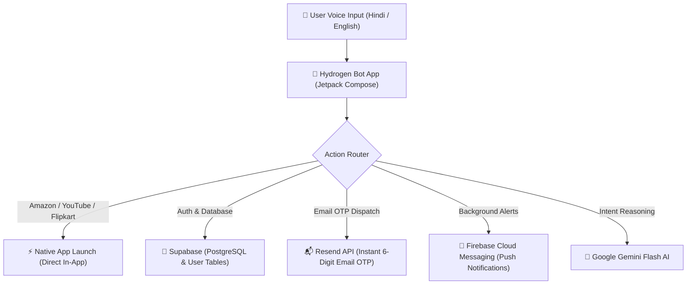

# ⚡ Hydrogen Bot (हाइड्रोजन बॉट)
> **Ultra-Fast, Lightweight Autonomous Voice Assistant for Android**

[](https://github.com/gitworld08210/Hydrogen-bot)
[](https://github.com/gitworld08210/Hydrogen-bot)
[](https://supabase.com)
[](https://resend.com)
[](https://firebase.google.com)

---

## 🏗️ Architecture Overview



---

## 🌟 Key Features

1. **Native App-First Intent Routing (`AppRouter.kt`)**:
   * **Amazon India Search:** Agar phone me Amazon app installed hai, toh **100% official Amazon App hi launch hogi**, web browser nahi.
   * **YouTube Search/Play:** Seedha official YouTube native app khulegi.
   * **Flipkart & WhatsApp:** Target-locked native app execution.

2. **Supabase Database & User Sync (`AuthManager.kt`)**:
   * User profiles, activity logs, aur memory **Supabase PostgreSQL** me sync rahenge.

3. **Resend Email OTP Service**:
   * Instant 6-digit verification code directly user ke email inbox me deliver hota hai via **Resend Email API**.

4. **Firebase Cloud Messaging (FCM Notifications)**:
   * Background alerts, reminders aur notifications deliver karne ke liye Firebase FCM integrate kiya gaya hai.

5. **Apple & Stripe Inspired "Clean White" UI (`ui/theme/` & `ui/components/`)**:
   * Pure White canvas (`#FFFFFF`) with soft pearl surfaces (`#F8FAFC`).
   * **Subtle & Gentle Mic Button:** Zero harsh neon; pure white circular button with a gentle sky-blue breathing ring (`#BAE6FD`).
   * High-contrast Slate Black typography (`#0F172A`) for effortless daylight readability.
   * Fluid 5-bar voice waveform visualizer reacting to audio volume.

6. **Hardware-Backed Biometric Vault (`EncryptedVaultManager.kt` & `VaultScreen.kt`)**:
   * Passwords, IRCTC profiles aur addresses **Android KeyStore (AES-256-GCM)** hardware encryption me store hote hain.
   * View karne se pehle **Fingerprint / Biometric scan** compulsory hai.

7. **Human-in-the-Loop Safety Gate (`SafetyGateCard.kt`)**:
   * Ticket booking (IRCTC) ya transactions ke waqt bot auto-fill karega, lekin **Payment/OTP screen aane se pehle 100% stop ho jayega** aur aawaz dega taaki user khud safely PIN enter kare.

---

## 🛠️ Configuration (`local.properties`)

Create or update `local.properties` in your project root:

```properties
sdk.dir=C\:\\Android

# Gemini AI Key (get free at https://aistudio.google.com)
GEMINI_API_KEY=your_gemini_api_key

# Supabase Credentials (Database & User tables)
SUPABASE_URL=https://your-project.supabase.co
SUPABASE_ANON_KEY=your-supabase-anon-key

# Resend API Key (Email OTP delivery)
RESEND_API_KEY=re_your_resend_api_key
```

---

## 🎤 Sample Voice Commands to Test

| Command (Hindi / English) | Action Performed |
| :--- | :--- |
| *"Mere liye Amazon pe running shoes search karo"* | Official **Amazon Native App** search results screen open |
| *"YouTube pe Arijit Singh ke gaane chalao"* | Official **YouTube Native App** search/play |
| *"Flipkart pe wireless earbuds dhundo"* | Official **Flipkart Native App** open |
| *"IRCTC kal ka train ticket check karo"* | Booking workflow + **Safety Guardrail Pause** |
