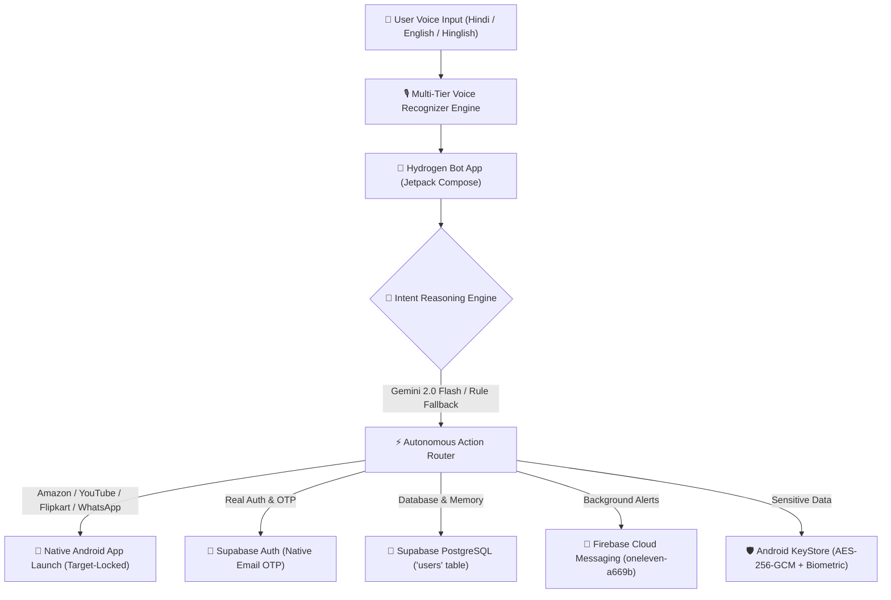

# ⚡ Hydrogen Bot (हाइड्रोजन बॉट)
> **Ultra-Fast, Lightweight Autonomous Voice Assistant & Native Action Bot for Android**

[](https://github.com/gitworld08210/Hydrogen-bot)
[](https://github.com/gitworld08210/Hydrogen-bot)
[](https://supabase.com)
[](https://supabase.com)
[](https://firebase.google.com)
[](https://github.com/gitworld08210/Hydrogen-bot/raw/main/release/HydrogenBot-v1.2.apk)

---

## 📲 Direct APK Download (v1.2 - Latest Stable Release)

Aap seedha apne Android phone me latest signed APK download aur install kar sakte hain:

👉 **[Download HydrogenBot-v1.2.apk (Direct Download)](https://github.com/gitworld08210/Hydrogen-bot/raw/main/release/HydrogenBot-v1.2.apk)** *(Size: ~13.9 MB)*

### 🆕 What's New in v1.2:
* 📬 **Real Supabase Auth Email OTP Delivery:** Zero hardcoded demo codes. Real 6-digit OTPs are delivered directly to your Gmail inbox via Supabase Auth (`/auth/v1/otp`) and verified against `/auth/v1/verify`.
* 🎙️ **Multi-Tier Robust Speech Recognizer Engine:** Fixed the OEM `"Voice recognition available nahi hai"` issue on Realme, Oppo, Xiaomi, and Samsung devices by implementing a 3-tier fallback (System Recognizer → Google Recognition Service Component → Direct Speech Engine) with Android 11+ `<queries>`.
* 🎨 **Luxury Editorial Minimalist UI:** 
  * 4 Organic blurred black sound capsules matching high-end design standards.
  * Contoured bottom dock with an Obsidian black mic button and diffused halo glow.
  * Curated 2-column "AI Ask" e-commerce cards with instant deep-link routing.

---

## 🏗️ Architecture Overview



---

## 🌟 Core Features

### 1. 📱 Native App-First Intent Routing (`AppRouter.kt`)
Browser me slow web links kholne ke bajaye, Hydrogen Bot seedhe target Android apps me deep-link karta hai:
* **Amazon India Search:** `in.amazon.mShop.android.shopping` native search intent direct launch hota hai.
* **YouTube Play / Search:** `com.google.android.youtube` official native app execute hoti hai.
* **Flipkart Shopping:** `com.flipkart.android` open hota hai.
* **WhatsApp Direct Actions:** `com.whatsapp` target-locked conversation triggers.
* **Smart Fallback:** Agar app installed nahi hai, toh smooth browser/store redirect fallback.

### 2. 🔐 Real Supabase Auth & Email OTP (`AuthManager.kt`)
* Real email verification directly connected to Supabase (`hjxesslwvimpgxazwmep.supabase.co`).
* Instant 6-digit OTP delivery to Gmail inbox without hardcoding.
* Session tokens securely stored in Encrypted SharedPreferences.
* Resend API support (`re_...`) ready as dual-provider fallback.

### 3. 🎨 Editorial Minimalist UI (`ui/screens/` & `ui/components/`)
* **Organic Sound Capsules:** 4 dynamic soundwave capsules reacting smoothly to speech and volume levels.
* **Contoured Bottom Dock:** Ergonomic bottom navigation dock with a centered Obsidian black mic button and subtle halo breathing ring.
* **Dual View Modes:** 
  1. *Voice Chat View:* Focused voice conversation and intent feedback.
  2. *AI Ask Shopping View:* 2-column curated product recommendation cards with discount badges and direct buy buttons.
* **Editorial Auth Screen:** "HYDROGEN +" luxury minimalist authentication interface.

### 4. 🛡️ Hardware Biometric Vault (`EncryptedVaultManager.kt`)
* Sensitive user data (addresses, booking profiles, payment info) **Android KeyStore (AES-256-GCM)** hardware encryption me store hota hai.
* Access ke liye **Fingerprint / BiometricPrompt** verification mandatory hai.

### 5. 🛑 Human-in-the-Loop Safety Gate (`SafetyGateCard.kt`)
* Ticket booking (IRCTC) ya checkout ke dauran Hydrogen bot forms fill karega, lekin **Payment / OTP screen par 100% pause le lega** aur user ko manually approve karne bolega. 100% financial security guaranteed.

---

## 🛠️ Configuration (`local.properties`)

Project ko build karne ke liye root directory me `local.properties` configure karein:

```properties
sdk.dir=C\:\\Android

# Google Gemini API Key
GEMINI_API_KEY=your_gemini_api_key

# Supabase PostgreSQL & Auth Credentials
SUPABASE_URL=https://hjxesslwvimpgxazwmep.supabase.co
SUPABASE_ANON_KEY=your_supabase_anon_key

# Optional Resend API Key for Email OTP
RESEND_API_KEY=re_your_resend_api_key
```

---

## 🎤 Sample Voice Commands to Test

| Voice Command (Hindi / English) | Execution Mode | Target Native App |
| :--- | :--- | :--- |
| *"Amazon pe running shoes dikhao"* | Native Deep-Link | **Amazon Shopping App** |
| *"YouTube pe latest tech podcast chalao"* | Native Deep-Link | **YouTube Official App** |
| *"Flipkart pe wireless earbuds dhundo"* | Native Deep-Link | **Flipkart Official App** |
| *"WhatsApp pe mummy ko message bhejo"* | Native Intent | **WhatsApp Native App** |
| *"IRCTC kal ka train ticket check karo"* | Autonomous Routing | **IRCTC + Safety Gate Stop** |

---

## 📦 Build from Source

```bash
# Clone the repository
git clone https://github.com/gitworld08210/Hydrogen-bot.git
cd Hydrogen-bot

# Build Release APK
./gradlew assembleRelease

# The generated APK will be in:
# app/build/outputs/apk/release/app-release-unsigned.apk
```

---

## 📄 License
MIT License • Built with ❤️ for autonomous mobile intelligence.
