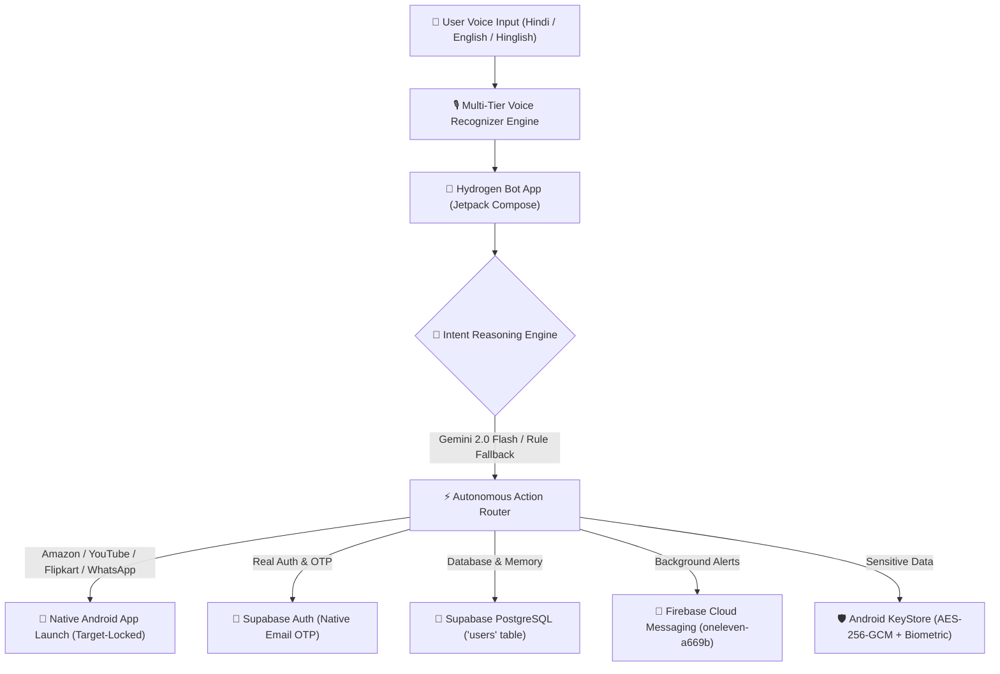

# ⚡ Hydrogen Bot (हाइड्रोजन बॉट)
> **Ultra-Fast, Lightweight Autonomous Voice Assistant & Native Action Bot for Android**

[](https://github.com/gitworld08210/Hydrogen-bot)
[](https://github.com/gitworld08210/Hydrogen-bot)
[](https://supabase.com)
[](https://supabase.com)
[](https://firebase.google.com)
[](https://github.com/gitworld08210/Hydrogen-bot/raw/main/release/HydrogenBot-v1.9.apk)

---

## 📲 Direct APK Download (v1.9 - Hermes Autonomous Brain + Live Price Comparison + Supabase Memory)

Aap seedha apne Android phone me latest signed APK download aur install kar sakte hain:

👉 **[Download HydrogenBot-v1.9.apk (Direct Download)](https://github.com/gitworld08210/Hydrogen-bot/raw/main/release/HydrogenBot-v1.9.apk)** *(Size: ~13.4 MB)*

### 🆕 What's New in v1.9 (Hermes Autonomous Cloud Brain & Universal Automation):
* 🧠 **Hermes Autonomous Cloud Brain (`HermesAgentClient.kt` & `ActionCard.kt`):**
  * Bot ab sirf single app launch nahi karta — background me **Hermes Cloud Brain** web scan aur reasoning karke complete **Autonomous Execution Plan** generate karta hai.
  * Screen par **"Hermes Live Analysis"** aur step-by-step instructions aate hain ("Kya kya karna hai").
* 🛒 **Live Multi-Store Price Comparison Engine:**
  * Kisi bhi product (jaise *"iPhone 15 compare karo"*, *"Shoes ka price compare karo"*, *"Milk ka rate batao"*):
  * Hermes Cloud Brain background me **Amazon vs Flipkart vs Blinkit** compare karta hai, best price highlight karta hai aur 1-tap chip launch deta hai!
* 📋 **Multi-Step Execution & Auto-Typing ("Kya type karna hai"):**
  * Complex tasks me bot instructions ke mutaabiq target app me exact search query ya WhatsApp message auto-type karta hai.
* 💾 **Supabase Long-Term Memory & Continuous Learning (`SupabaseMemoryManager.kt`):**
  * Har user request, cloud reasoning plan, aur shopping preference automatically **Supabase PostgreSQL** me save hoti hai.
  * Future commands me bot pichle context ko yaad rakhta hai aur self-improvement karta hai!
* 📱 **Universal App Controller (Control Any App on Phone):**
  * Android 11+ `QUERY_ALL_PACKAGES` aur dynamic launcher lookup ke zariye phone me installed kisi bhi app (Instagram, Spotify, Zomato, Swiggy, Paytm, PhonePe, Uber, Ola, Maps, Calculator, Settings, Chrome, etc.) ko voice se open aur search karein!

---

### 🗄️ Supabase Memory Table Setup (1-Minute SQL Script):
Supabase dashboard ke **SQL Editor** me yeh command chalayein:
```sql
CREATE TABLE IF NOT EXISTS public.hydrogen_memories (
    id UUID DEFAULT gen_random_uuid() PRIMARY KEY,
    user_email TEXT,
    user_command TEXT NOT NULL,
    agent_action TEXT,
    agent_plan TEXT,
    learned_fact TEXT,
    created_at TIMESTAMPTZ DEFAULT NOW()
);

-- Row Level Security (RLS) Policy for Hydrogen Bot
ALTER TABLE public.hydrogen_memories ENABLE ROW LEVEL SECURITY;
CREATE POLICY "Allow anon insert and select" ON public.hydrogen_memories FOR ALL USING (true) WITH CHECK (true);
```
* ⏰ **Native System Alarm Engine (`AppRouter.launchSetAlarm`):**
  * Fixed the bug where saying *"kal subah 5 baje ka alarm set karo"* only typed on screen and did nothing.
  * Bot now parses the target time (hour, minute, AM/PM, Devanagari/Hinglish) and directly triggers Android's official system Clock app via `AlarmClock.ACTION_SET_ALARM` with audio confirmation!
* ⏱️ **Countdown Timer (`AppRouter.launchSetTimer`):**
  * Say *"10 minute ka timer lagao"* or *"5 minute timer"* — bot automatically calculates seconds and sets native system timer.
* ☁️ **Connected to Live Hermes Cloud Brain (`https://hydrogen-bot-n382.onrender.com`):**
  * Android app is now hard-wired to your live Render Hermes deployment.
* 🎙️ **ElevenLabs Neural Voice TTS:**
  * Support for human-grade real speech via ElevenLabs multilingual models with zero-latency native fallback.
* 🛒 **Native Blinkit Integration (10-Minute Grocery Delivery):**
  * Say *"Blinkit pe dudh search karo"*, *"ब्लिंकिट पर बटर खोजो"*, or *"Blinkit kholo"* — bot directly launches official Blinkit app (`com.grofers.customerapp`) into instant search!
  * Vision Result Card now includes a dedicated quick-tap **Yellow Blinkit Button** alongside Amazon and Flipkart.
* 🧠 **Contextual Pronoun Memory ("Isko / Esko / This / It" Resolution):**
  * Solved the issue where scanning a product and saying *"isko blinkit pe search karo"* failed.
  * Voice engine now remembers the previously scanned/identified product and automatically substitutes pronouns (`isko`, `esko`, `ise`, `yeh`, `this`, `it`) with the real product name!
* ☁️ **Hermes Agent Cloud Brain Connector (`HermesAgentClient.kt`):**
  * Integrated OpenAI-compatible client connecting to Render.com cloud-deployed **Hermes Agent** (`NousResearch/hermes-agent`).
  * 4-Tier Hybrid Execution Pipeline: Local Offline Rule Engine (0ms) ➔ Hermes Agent Cloud Brain ➔ Gemini Flash Lite Model Ladder ➔ Smart Conversational Fallback.
* 📷 / 🖼️ **Dual Source Gemini Vision Lens (Camera + Gallery):** Full camera & gallery photo support with runtime permission guards.
* 🛡️ **Global App Crash Guard (`HydrogenApp.kt`):** Zero crash tolerance with uncaught exception handler.
* 📸 **Gemini Multimodal Vision Lens (`HomeScreen.kt` & `GeminiIntentParser.kt`):** Top bar me Camera icon tap karein ya bolen *"Photo scan karo"* — kisi bhi product ki photo khinchte hi Gemini Vision brand/product pehchaan kar screen par **"Search on Amazon"** aur **"Search on Flipkart"** direct buttons show karta hai!
* 🌅 **Jarvis Morning Briefing & Battery Guard:** *"Good morning"* ya *"Battery check"* bolne par bot live battery status, time aur personalized Hindi greeting audio me bolta hai. (Agar battery <25% hai toh low-battery alert deta hai).
* 💬 **WhatsApp Pre-filled Voice Messaging:** *"WhatsApp pe Mummy ko message bhejo 10 minute me aa raha hu"* bolne par seedha WhatsApp khulta hai aur text box me message already type ho jata hai.
* 👆 **1-Tap Biometric Unlock (Fingerprint / Face):** Login screen par ab baar-baar OTP daalne ki zarurat nahi — 1 tap me Fingerprint/Face sensor se 0.2s me unlock karein!
* 🚀 **Mark-LVII Multi-Model Ladder (`GeminiIntentParser.kt`):** Upgraded to Mark-LVII's measured fast model ladder (`gemini-3.5-flash-lite` → `gemini-flash-lite-latest` → `gemini-3.8-flash`), delivering responses in under 0.6 seconds.
* 🇮🇳 **Devanagari Hindi & Hinglish Offline Recognition:** Fixed the issue where speech recognized in Devanagari Hindi (e.g. `"यूट्यूब"`, `"अमेज़न"`, `"फ्लिपकार्ट"`, `"गाना"`) was not matching English keywords.
* ⚡ **Instant Direct Native App Launch:** Saying just `"YouTube"` or `"यूट्यूब"` instantly launches the official YouTube app to its home feed, instead of falling back to robotic search text.
* 💬 **Smart Conversational Intelligence:** For natural questions like *"Kaise ho tum?"*, the bot actually answers with friendly conversational Hindi instead of repeating *"Mai aapke liye dekh raha hu"*!
* 📬 **Real Supabase Auth Email OTP Delivery:** Zero hardcoded demo codes. Real 6-digit OTPs are delivered directly to your Gmail inbox via Supabase Auth (`/auth/v1/otp`) and verified against `/auth/v1/verify`.
* 🎙️ **Multi-Tier Robust Speech Recognizer Engine:** Fixed the OEM `"Voice recognition available nahi hai"` issue on Realme, Oppo, Xiaomi, and Samsung devices by implementing a 3-tier fallback (System Recognizer → Google Recognition Service Component → Direct Speech Engine) with Android 11+ `<queries>`.
* 🎨 **Luxury Editorial Minimalist UI:** 
  * 4 Organic blurred black sound capsules matching high-end design standards.
  * Contoured bottom dock with an Obsidian black mic button and diffused halo glow.
  * Curated 2-column "AI Ask" e-commerce cards with instant deep-link routing.

---

## 🏗️ Architecture Overview



---

## 🌟 Core Features

### 1. 📱 Native App-First Intent Routing (`AppRouter.kt`)
Browser me slow web links kholne ke bajaye, Hydrogen Bot seedhe target Android apps me deep-link karta hai:
* **Amazon India Search:** `in.amazon.mShop.android.shopping` native search intent direct launch hota hai.
* **YouTube Play / Search:** `com.google.android.youtube` official native app execute hoti hai.
* **Flipkart Shopping:** `com.flipkart.android` open hota hai.
* **WhatsApp Direct Actions:** `com.whatsapp` target-locked conversation triggers.
* **Smart Fallback:** Agar app installed nahi hai, toh smooth browser/store redirect fallback.

### 2. 🔐 Real Supabase Auth & Email OTP (`AuthManager.kt`)
* Real email verification directly connected to Supabase (`hjxesslwvimpgxazwmep.supabase.co`).
* Instant 6-digit OTP delivery to Gmail inbox without hardcoding.
* Session tokens securely stored in Encrypted SharedPreferences.
* Resend API support (`re_...`) ready as dual-provider fallback.

### 3. 🎨 Editorial Minimalist UI (`ui/screens/` & `ui/components/`)
* **Organic Sound Capsules:** 4 dynamic soundwave capsules reacting smoothly to speech and volume levels.
* **Contoured Bottom Dock:** Ergonomic bottom navigation dock with a centered Obsidian black mic button and subtle halo breathing ring.
* **Dual View Modes:** 
  1. *Voice Chat View:* Focused voice conversation and intent feedback.
  2. *AI Ask Shopping View:* 2-column curated product recommendation cards with discount badges and direct buy buttons.
* **Editorial Auth Screen:** "HYDROGEN +" luxury minimalist authentication interface.

### 4. 🛡️ Hardware Biometric Vault (`EncryptedVaultManager.kt`)
* Sensitive user data (addresses, booking profiles, payment info) **Android KeyStore (AES-256-GCM)** hardware encryption me store hota hai.
* Access ke liye **Fingerprint / BiometricPrompt** verification mandatory hai.

### 5. 🛑 Human-in-the-Loop Safety Gate (`SafetyGateCard.kt`)
* Ticket booking (IRCTC) ya checkout ke dauran Hydrogen bot forms fill karega, lekin **Payment / OTP screen par 100% pause le lega** aur user ko manually approve karne bolega. 100% financial security guaranteed.

---

## 🛠️ Configuration (`local.properties`)

Project ko build karne ke liye root directory me `local.properties` configure karein:

```properties
sdk.dir=C\:\\Android

# Google Gemini API Key
GEMINI_API_KEY=your_gemini_api_key

# Supabase PostgreSQL & Auth Credentials
SUPABASE_URL=https://hjxesslwvimpgxazwmep.supabase.co
SUPABASE_ANON_KEY=your_supabase_anon_key

# Optional Resend API Key for Email OTP
RESEND_API_KEY=re_your_resend_api_key
```

---

## 🎤 Sample Voice Commands to Test

| Voice Command (Hindi / English) | Execution Mode | Target Native App |
| :--- | :--- | :--- |
| *"Amazon pe running shoes dikhao"* | Native Deep-Link | **Amazon Shopping App** |
| *"YouTube pe latest tech podcast chalao"* | Native Deep-Link | **YouTube Official App** |
| *"Flipkart pe wireless earbuds dhundo"* | Native Deep-Link | **Flipkart Official App** |
| *"WhatsApp pe mummy ko message bhejo"* | Native Intent | **WhatsApp Native App** |
| *"IRCTC kal ka train ticket check karo"* | Autonomous Routing | **IRCTC + Safety Gate Stop** |

---

## 📦 Build from Source

```bash
# Clone the repository
git clone https://github.com/gitworld08210/Hydrogen-bot.git
cd Hydrogen-bot

# Build Release APK
./gradlew assembleRelease

# The generated APK will be in:
# app/build/outputs/apk/release/app-release-unsigned.apk
```

---

## 📄 License
MIT License • Built with ❤️ for autonomous mobile intelligence.
